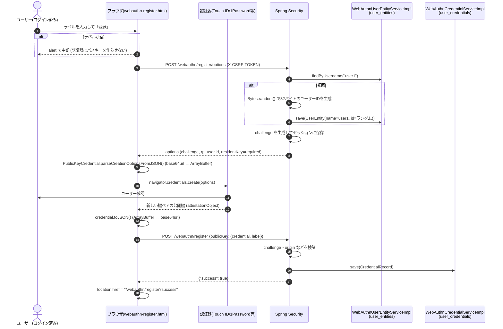
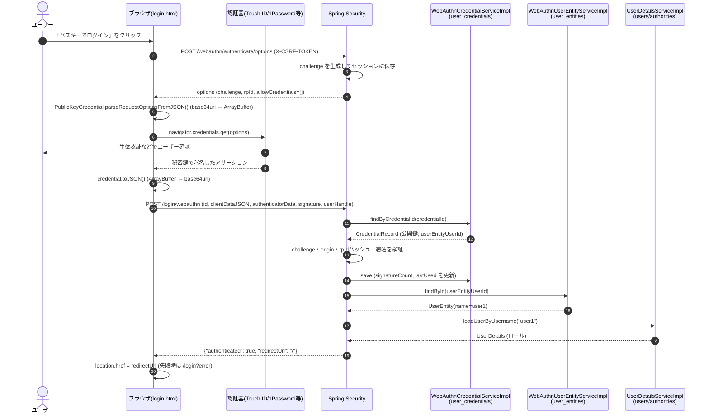

# login-demo

## パスキーの処理の流れ

画面と JS は自前 (`login.html` / `webauthn-register.html`)。サーバー側のエンドポイントと検証は Spring Security (`http.webAuthn(...)`) が処理する。

### 登録



### ログイン



- ユーザーを特定するキーは、ブラウザが送る `userHandle` ではなく、credential ID で取得した `CredentialRecord` の `userEntityUserId`
- WebAuthn 用ユーザーIDは `user1` のハッシュではなく `SecureRandom` の32バイト (仕様上、個人を特定できる情報を入れないことが推奨されている)

## H2 データベースの確認

データはアプリ起動時に組み込み H2 (メモリ) に作られ、アプリを停止すると消える。

- テーブル定義: `src/main/resources/schema.sql`
- 初期データ (`user1` / `password`): `src/main/resources/data.sql`

| テーブル | 内容 |
|---|---|
| `users` / `authorities` | アカウント (ユーザー名, パスワード, ロール) |
| `user_entities` | ユーザー名 ↔ WebAuthn 用ユーザーID |
| `user_credentials` | パスキー (credential ID, 公開鍵, 署名カウンタ, ラベルなど) |

### H2 Console で中身を見る

1. アプリを起動し、ログから JDBC URL を探す (URL は起動のたびに変わる)

   ```
   H2 console available at '/h2-console'. Database available at 'jdbc:h2:mem:xxxxxxxx-...'
   ```

2. http://localhost:8080/h2-console を開き、次の値で「Connect」を押す
   - JDBC URL: 1. の `jdbc:h2:mem:...`
   - User Name: `sa`
   - Password: (空)

3. SQL を実行する。例えばアカウントからパスキーまでの紐づきは次のとおり

   ```sql
   select u.username, e.id as webauthn_user_id, c.label, c.signature_count, c.last_used
   from users u
   left join user_entities e on e.name = u.username
   left join user_credentials c on c.user_entity_user_id = e.id;
   ```

### 実行される SQL をログで見る

`application.properties` で次のログを有効にしている。

- `org.springframework.jdbc.core=DEBUG`: 実行される SQL
- `org.springframework.jdbc.core.StatementCreatorUtils=TRACE`: バインドされるパラメータ

パスキーでログインすると、おおよそ次の順に SQL が出る。

1. `SELECT ... FROM user_credentials WHERE credential_id = ?` (パスキーを検索)
2. `UPDATE user_credentials ...` (署名カウンタ・最終利用日時を更新)
3. `SELECT ... FROM user_entities WHERE id = ?` (WebAuthn 用ユーザーID からユーザー名を取得)
4. `users` / `authorities` の SELECT (アカウントとロールを取得)

### 注意

- H2 Console はログインなしで開ける実験用の設定 (`SecurityConfig` で `/h2-console/**` の CSRF チェックを無効化し、X-Frame-Options を `SAMEORIGIN` にしている)。ローカル以外では有効にしないこと

## フルスクラッチ版パスキー

Spring Security のパスキー実装 (`/webauthn/**`) とは別に、サーバー側の検証を自前で書いたもの。
コードは `dev.yuizho.login_demo.scratch.webauthn` パッケージにまとめている。JDK の `java.security` と自前の CBOR デコーダだけで検証し、Spring Security には CSRF チェックと、最後にログイン済みのセッションを作る部分だけを任せている。

| 画面 / API | 内容 |
|---|---|
| `GET /scratch/register` | 登録画面 (ログイン必須) |
| `GET /scratch/login` | ログイン画面 |
| `POST /scratch/webauthn/register/options`, `POST /scratch/webauthn/register` | 登録 |
| `POST /scratch/webauthn/authenticate/options`, `POST /scratch/webauthn/authenticate` | ログイン |

データは `scratch_user_handles` / `scratch_credentials` テーブルに保存する (Spring 版とは別のテーブル)。同じ認証器でも、Spring 版とは別のパスキーとして登録される。

### サーバーで検証していること

- 登録 (`ScratchRegistrationService`)
  1. clientDataJSON: `type` が `webauthn.create`、`challenge` がセッションの値と一致、`origin` が許可したもの
  2. attestationObject を CBOR でデコード (`fmt` = `none` 前提で、attStmt は検証しない)
  3. authData: rpIdHash = SHA-256(rpId)、UP / UV / AT フラグ、credentialId = `credential.id`
  4. 公開鍵 (COSE) が ES256 (alg = -7) であること。COSE のまま保存する
- ログイン (`ScratchAuthenticationService`)
  1. credential ID で保存済みの公開鍵を探し、userHandle が一致すること
  2. clientDataJSON: `type` が `webauthn.get`、`challenge`、`origin`
  3. authData: rpIdHash、UP / UV フラグ
  4. 署名: `authData || SHA-256(clientDataJSON)` に対する ECDSA の署名を、COSE から変換した公開鍵で検証
  5. 署名カウンタが増えていること (保存済みも今回も 0 なら見ない。同期パスキーは常に 0)
  6. userHandle → ユーザー名 → `UserDetailsService` でアカウントを取得し、`SecurityContext` をセッションに保存

勉強用なので、検証に失敗したら例外を投げて 400 を返し、ログに WARN を出すだけ。各ステップは `[scratch]` で始まる INFO ログに出る。
